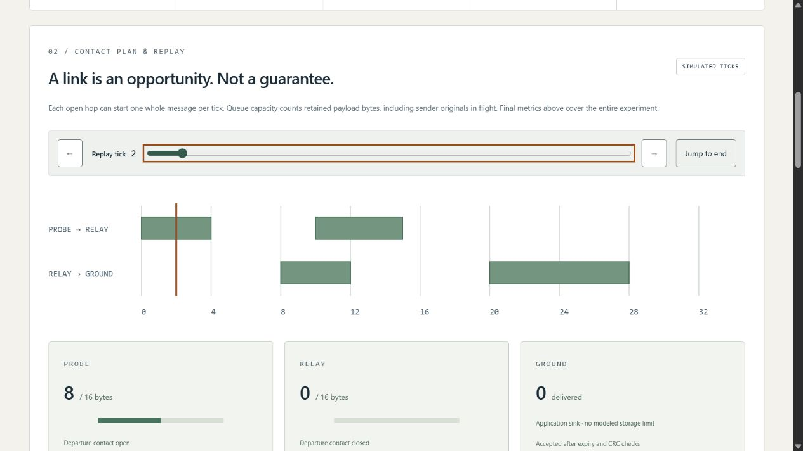

# Delay Tolerant Mission Network Lab

**Keep the message. Wait for the link.** An offline, reproducible store-and-forward networking workbench by [Jason Stys](https://github.com/JasonStys).

Explore what happens when a synthetic probe cannot immediately reach a relay or ground sink: limited storage, intermittent contacts, propagation delay, expiry, corrupt copies, duplicate arrivals, competing priorities, and a worker restart with messages in flight. A dependency-free **Rust** worker produces the results; a separately implemented **Python** model checks every event, queue sample, and final message before evidence is displayed. **TypeScript, HTML, CSS, and SVG** provide an accessible interactive replay; **SQL** provides optional immutable local evidence storage.

This is an educational three-node simulator, **not BPv7 interoperability, a radio stack, BPSec, spacecraft software, or a flight-qualified system**. All contacts and data are invented. No real equipment or network endpoints are contacted. See [model assumptions](docs/MODEL.md).



## What it demonstrates

- Store/carry/forward behavior with one logical owner, bounded retained payload bytes, receiver backpressure, and retries.
- Nine experiments, including source-order FIFO versus earliest expiry, exact TTL boundaries, corruption, duplicate suppression, no contact, and an empty network.
- Tick-by-tick replay without exposing future message state; exact contact tables, queue occupancy, message outcomes, and a filterable full-run event ledger.
- A real two-process restart: serialize ownership and in-flight state, exit, validate a checkpoint, and resume in a fresh Rust process. The CLI can commit/reopen the handoff through SQLite first.
- Deterministic JSON/full HTML evidence, numeric queue CSV, editable input JSON, provenance, and SHA-256 identities. No automatic history collection.
- Strict bounds, malformed-input tests, independent differential verification across all 162 finite UI configurations, generated exact-line source documentation, and cross-platform portable builds.

## Run the portable application

Download a ZIP and its matching `.sha256` file from [Releases](https://github.com/JasonStys/delay-tolerant-mission-network-lab/releases/latest). Verify its digest, then extract **the entire ZIP** to a user-owned folder. Never run from inside the ZIP or separate the executable from `_internal`.

- Windows x64: open `MissionNetworkLab.exe`.
- Linux x64: `chmod +x MissionNetworkLab` if extraction did not retain executable permissions, then `./MissionNetworkLab`.
- macOS arm64: launch the corresponding `MissionNetworkLab` executable from Terminal.

The launcher opens a local browser on an ephemeral `127.0.0.1` port. Keep its console open; Ctrl+C stops it. No installer, administrator access, account, cloud service, Python, Node, or Rust installation is required for the portable app. Bundles are **unsigned**; do not bypass OS security warnings. Source builds are available if your policy disallows unsigned downloads. These are desktop bundles, not mobile installers or a public hosted service.

## Run from source

Use Python 3.12–3.14, Node 24, and the pinned Rust 1.98.1 toolchain. Runtime Python and Rust have no third-party dependencies; development/browser/build dependencies are locked.

```powershell
python -m venv .venv
.venv/Scripts/python -m pip install --require-hashes -r requirements-dev.lock
npm ci
rustup toolchain install 1.98.1 --profile minimal --component clippy,rustfmt,rust-docs
cargo build --release --locked
npm run build
.venv/Scripts/python -m dtnlab serve
```

On macOS/Linux use `.venv/bin/python` instead of `.venv/Scripts/python`. The native executable must exist: verification never silently substitutes the Python reference for a missing Rust worker.

## Export and customize an experiment

The browser only accepts finite built-in settings. CLI input is an explicit local operation with a strict, bounded schema; it cannot execute payloads or select executable paths.

```powershell
.venv/Scripts/python -m dtnlab export --scenario restart-inflight --format json --output result.json
.venv/Scripts/python -m dtnlab export --input examples/restart.json --format json --output imported.json --history history.sqlite3 --checkpoint-store checkpoints.sqlite3
```

Output destinations must not exist. SQLite files are optional, unencrypted local files, ignored by Git, capped at 100 distinct entries, and never automatically pruned. History and checkpoint stores are distinct. The second command uses persisted checkpoint bytes in a fresh worker; it does not simulate power loss during a write. Read the [user guide](docs/USER_GUIDE.md) and [input/API contract](docs/API.md) before editing cases.

## Verification

```powershell
cargo fmt --check
cargo clippy --locked --all-targets -- -D warnings
cargo test --locked
.venv/Scripts/python -m ruff check dtnlab tests tools launcher.py
.venv/Scripts/python -m ruff format --check dtnlab tests tools launcher.py
.venv/Scripts/python -m mypy dtnlab
.venv/Scripts/python tools/verify_repo.py
.venv/Scripts/python -m pytest --cov=dtnlab --cov-report=term-missing
.venv/Scripts/python -m tools.benchmark
npm run format:check
npm test
npm run build
npx playwright install chromium firefox webkit
npm run test:e2e
.venv/Scripts/python tools/package_app.py
```

See [validation results and boundaries](docs/VALIDATION.md). GitHub Actions checks Linux/Windows/macOS, Python 3.12/3.14, three browser engines, dependency audits, CodeQL for Python/TypeScript, and real portable-app smoke tests. Workflows upload **no Actions artifacts or caches**. Release ZIPs are uploaded directly to a draft release only after the exact source commit's Validation and CodeQL workflows pass; final publication requires review.

## Repository map

| Path                                            | Responsibility                                                                             |
| ----------------------------------------------- | ------------------------------------------------------------------------------------------ |
| `rust/lib.rs`, `rust/main.rs`                   | Safe bounded network state machine, CRC/checkpoint validation, finite worker protocol      |
| `dtnlab/model.py`, `engine.py`                  | Strict inputs, invented scenarios, independent-agreement gate, evidence identity           |
| `dtnlab/reference.py`, `native.py`              | Independent Python replay; fixed-path native subprocess and restart orchestration          |
| `dtnlab/reports.py`, `server.py`, `__main__.py` | Inert exports, opt-in SQL history, protected loopback service and CLI                      |
| `dtnlab/resources/`                             | SQL schemas with immutable-entry triggers                                                  |
| `web/`                                          | Typed replay/contracts, accessible responsive presentation, production build configuration |
| `tests/`                                        | Native differential/property/security/HTTP tests and browser/unit checks                   |
| `tools/`                                        | Exact-line inventory, deterministic benchmarks, portable build/smoke/release tooling       |
| `examples/`, `docs/`                            | Editable synthetic case, complete documentation, results and actual screenshots            |
| `.github/workflows/`                            | Least-privilege pinned validation, security analysis, manual draft packaging               |

Each source file has a responsibility/creator header and definition contracts. [CODE_INDEX](docs/CODE_INDEX.md) gives generated exact line locations for functions, classes, fields, and variables without brittle duplicate line numbers in comments. [FILE_CATALOG](docs/FILE_CATALOG.md) summarizes **every** source-intent file; CI rejects stale indexes.

## Documentation and contact

[Architecture](docs/ARCHITECTURE.md) · [Model](docs/MODEL.md) · [API](docs/API.md) · [User guide](docs/USER_GUIDE.md) · [Validation](docs/VALIDATION.md) · [Release/runbook](docs/RELEASE.md) · [Security](SECURITY.md) · [Third-party notices](docs/THIRD_PARTY.md)

Created by **Jason Stys**. [Portfolio/contact profile](https://github.com/JasonStys) · [Project help/issues](https://github.com/JasonStys/delay-tolerant-mission-network-lab/issues). MIT source license. No agency, employer, standards-body, or mission affiliation or endorsement.
